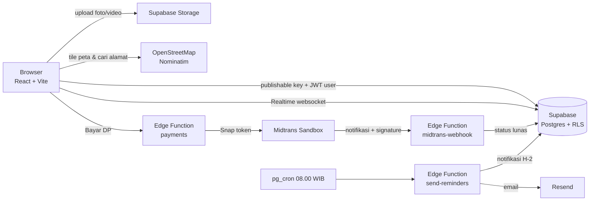

# CariMUA 💄

Platform untuk **mencari & booking makeup artist (MUA)**. Klien bisa mencari MUA berdasarkan kota, kategori, dan budget, melihat portofolio (look, model, sampai produk yang dipakai), lalu booking dengan **ongkos transport otomatis dari jarak** dan **DP 5%**. Setelah itu klien bisa chat langsung dengan MUA dan mendapat pengingat H-2. MUA mengelola profil, look, paket, tarif, jadwal, dan pembayaran dari satu dashboard.

🔗 **Demo:** https://carimua-nine.vercel.app
👤 **Akun demo** (tombol *Demo Klien / Demo MUA* di halaman login): `klien@carimua.test` dan `rina@carimua.test`, password `carimua123`

**Stack:** React 19 (Vite) · Tailwind CSS v4 · React Router v7 · Supabase (Postgres, Auth, Storage, Realtime, Edge Functions, pg_cron) · Midtrans Snap (sandbox) · Resend · Leaflet + OpenStreetMap · Vercel

> Dibuat dengan bantuan AI (Claude). Semua alur sudah diuji manual dan dengan script pengujian keamanan (RLS).

---

## Fitur

**Untuk klien**
- Login **email** atau **Google**, dengan peran **Klien / MUA** yang dipilih sekali saat daftar
- Pencarian MUA (wajib login) + filter **kategori, kota → area, budget**. Filter tersimpan di URL, jadi bisa di-share.
- Profil MUA bergaya portofolio: **look** (foto/video, model & produk opsional), video ala *Recent Videography*, paket & harga, Instagram, WhatsApp
- **Booking**: pilih paket, tanggal (tanggal yang sudah terisi kelihatan), lalu tandai lokasi di **peta**. **Ongkos transport dihitung otomatis** dari jarak MUA → lokasi acara.
- **Bayar DP 5%** lewat Midtrans Snap (QRIS, VA bank, e-wallet; mode sandbox). Booking otomatis **Terkonfirmasi** lewat webhook.
- **Chat realtime** dengan MUA (tanda dibaca ✓✓, badge pesan baru)
- **Kalender jadwal**, banner "x hari lagi", tombol **Simpan ke Google Calendar**
- **Notifikasi** (lonceng realtime) + **email pengingat H-2**
- **Riwayat transaksi** lengkap

**Untuk MUA**
- Dashboard: profil, kategori, Instagram, foto profil
- Kelola **look** (upload banyak foto/video per look). Profil baru tampil di pencarian setelah punya **minimal 2 look**.
- Kelola **paket & harga**, **lokasi (peta) + tarif transport per km + km gratis**
- **Booking masuk**: tandai selesai / batalkan, kalender, riwayat DP
- **Link bio Instagram + QR code** yang bisa diunduh

**Sistem**
- Harga, jarak, ongkos, total, dan DP **dihitung ulang di server** (trigger Postgres), jadi angka dari browser tidak bisa dicurangi
- 1 MUA hanya punya 1 jadwal aktif per tanggal
- Booking yang tidak dibayar DP dalam **24 jam otomatis dibatalkan** (pg_cron)
- **Row Level Security** di semua tabel. Pembayaran hanya bisa ditulis server.
- **Mode demo**: tanpa `.env`, website tetap jalan dengan data dummy (fitur baca saja)

---

## Arsitektur



| Kunci | Dipakai di | Rahasia? |
|---|---|---|
| `VITE_SUPABASE_URL`, `VITE_SUPABASE_PUBLISHABLE_KEY` | Browser (Vercel) | Tidak, data dijaga RLS |
| `VITE_MIDTRANS_CLIENT_KEY` | Browser (Vercel) | Tidak |
| `SUPABASE_SECRET_KEY` | `.env` lokal, hanya untuk `npm run seed` | **Ya** |
| `MIDTRANS_SERVER_KEY`, `RESEND_API_KEY` | Supabase Edge Function Secrets | **Ya** |

## Struktur project

```
supabase/
  schema.sql … 07_notifications.sql   ← skema database, dijalankan berurutan
  functions/payments                  ← buat transaksi DP (Midtrans Snap)
  functions/midtrans-webhook          ← terima notifikasi pembayaran
  functions/send-reminders            ← pengingat H-2 (notifikasi + email)
scripts/seed.js                       ← isi data dummy + aktivitas demo (npm run seed)
public/images/README.md               ← daftar foto yang perlu kamu isi sendiri
src/
  auth/        ← status login + peran, proteksi halaman
  lib/         ← api (data publik), storage, geo (jarak & ongkos), payments, chat, bookings, format
  components/  ← Layout, kartu, filter, LocationPicker (peta), kalender, lonceng, chat, dashboard/*
  pages/       ← Home, MuaList, MuaProfile, BookingPage, ClientHome, Dashboard, ChatPage, Login, …
```

## Desain database

| Tabel / view | Isi |
|---|---|
| `profiles` | 1 baris per akun: peran `client` / `mua`, nama, foto |
| `mua_profiles` | profil publik MUA + lokasi dasar, tarif/km, km gratis, Instagram |
| `categories`, `mua_categories` | kategori (Wedding, Wisuda, …) many-to-many |
| `packages` | paket & harga MUA |
| `looks`, `portfolio_photos` | portofolio: 1 look → banyak foto/video, model & produk opsional |
| `bookings` | booking + jarak, ongkos, total, DP (dihitung trigger), status |
| `payments` | riwayat transaksi DP Midtrans |
| `conversations`, `messages` | chat klien ↔ MUA |
| `notifications` | notifikasi web + status email |
| view `mua_list` | MUA dengan ≥ 2 look + kisaran harga + kategori (dipakai pencarian) |

---

## Menjalankan di laptop

Butuh **Node.js 20+** (project ini dibuat dengan Node 24 LTS).

```bash
npm install
npm run dev
```

Buka http://localhost:5173. Tanpa `.env`, website berjalan dalam **mode demo** (ada banner kuning di atas).

## Menghubungkan Supabase (langkah demi langkah)

### 1. Buat project Supabase
1. Daftar / login di https://supabase.com, lalu klik **New project**.
2. Isi nama project (misalnya `carimua`), buat **database password**, dan pilih region terdekat.

### 2. Jalankan SQL
Di **SQL Editor → New query**, jalankan file di folder `supabase/` **berurutan**, masing-masing di query baru:
1. `schema.sql`: tabel MUA, paket, foto, RLS, storage
2. `02_roles.sql`: peran Klien / MUA + trigger akun baru
3. `03_looks.sql`: portofolio look (foto/video), Instagram, aturan minimal 2 look
4. `04_bookings.sql`: lokasi & tarif MUA, booking, harga/ongkos/DP dihitung server
5. `05_payments.sql`: riwayat pembayaran
6. `06_chat.sql`: chat realtime
7. `07_notifications.sql`: notifikasi, cron pengingat H-2 & pembatalan otomatis. **Ganti URL function di bagian cron** dengan project-ref kamu.

> **Ongkos transport:** jarak = rumus haversine (garis lurus) × 1.3 sebagai perkiraan jarak tempuh. Ongkos = (jarak − km gratis, dibulatkan ke atas) × tarif per km dari MUA. Peta memakai tile standar OpenStreetMap dan pencarian alamat memakai Nominatim (gratis, tanpa API key).

### 3. Isi `.env`
Salin `.env.example` menjadi `.env`, lalu isi dari **Project Settings → API Keys**:
- **Project URL** → `VITE_SUPABASE_URL`
- **Publishable key** → `VITE_SUPABASE_PUBLISHABLE_KEY`
- **Secret key** → `SUPABASE_SECRET_KEY` (rahasia, hanya untuk seed, jangan ke Vercel)

### 4. Isi data dummy
```bash
npm run seed
```
Membuat 8 MUA dummy (profil, look, paket, lokasi & tarif) + akun **Klien Demo** lengkap dengan 3 booking, riwayat DP, dan chat dengan Rina. Password semua akun: `carimua123`. Nomor WhatsApp dummy sengaja memakai awalan `62800…` supaya tidak nyasar ke nomor orang sungguhan.

### 5. Login Google
1. Di https://console.cloud.google.com buat **OAuth client ID** (*Web application*). Isi **Authorized redirect URI** dengan `https://<project-ref>.supabase.co/auth/v1/callback`.
2. Lengkapi **Branding** (beranda, `/privasi`, `/syarat`), lalu **Publish app** di menu Audience.
3. Salin **Client ID** & **Client secret** ke Supabase **Authentication → Sign In / Providers → Google**.

Akun yang pertama kali login lewat Google akan diminta memilih peran di `/pilih-peran`.

### 6. Pembayaran DP (Midtrans Sandbox)
Alur: klien klik **Bayar DP** → function `payments` membuat transaksi Snap (nominal diambil dari database) → klien bayar → Midtrans memanggil `midtrans-webhook` (dicek tanda tangan SHA-512 + status diambil ulang dari API Midtrans) → booking **Terkonfirmasi** dan tercatat di `payments`.

1. Daftar di https://dashboard.midtrans.com, pilih environment **Sandbox**, lalu buka **Settings → Access Keys**.
2. **Client Key** → `.env` & Vercel sebagai `VITE_MIDTRANS_CLIENT_KEY`. **Server Key** → Supabase **Edge Functions → Secrets** sebagai `MIDTRANS_SERVER_KEY`.
3. Deploy functions (sekali `npx supabase login` dulu):
   ```bash
   npx supabase functions deploy payments --project-ref <project-ref> --no-verify-jwt --use-api
   npx supabase functions deploy midtrans-webhook --project-ref <project-ref> --no-verify-jwt --use-api
   npx supabase functions deploy send-reminders --project-ref <project-ref> --no-verify-jwt --use-api
   ```
4. Midtrans **Settings → Payment → Notification URL**: `https://<project-ref>.supabase.co/functions/v1/midtrans-webhook`
5. Tes: pilih **BCA Virtual Account**, lalu bayar di https://simulator.sandbox.midtrans.com/bca/va/index (uang simulasi).

### 7. Email pengingat H-2 (Resend)
Buat API key di https://resend.com, lalu simpan sebagai secret `RESEND_API_KEY` di Supabase.

> Tanpa domain sendiri, Resend hanya bisa mengirim dari `onboarding@resend.dev` **ke email pemilik akun Resend**. Untuk mengirim ke semua pengguna: verifikasi domain di Resend, lalu isi secret `EMAIL_FROM` (contoh `CariMUA <halo@domainkamu.com>`). Notifikasi web tetap jalan untuk semua orang.

## Deploy ke Vercel

1. Import repo GitHub di https://vercel.com (preset **Vite** terdeteksi otomatis).
2. **Environment Variables**: isi **hanya** variabel `VITE_*` (`VITE_SUPABASE_URL`, `VITE_SUPABASE_PUBLISHABLE_KEY`, `VITE_MIDTRANS_CLIENT_KEY`).
3. Di Supabase **Authentication → URL Configuration**, isi **Site URL** `https://<project>.vercel.app` dan **Redirect URLs** `https://<project>.vercel.app/**` + `http://localhost:5173/**`.

`vercel.json` berisi aturan *rewrite*, jadi URL seperti `/mua/rina-makeup` tetap bisa dibuka langsung atau di-refresh tanpa 404.

## Foto
Slot foto di beranda & halaman login menampilkan kotak 📷 berisi nama file sampai kamu menaruh fotonya di `public/images/`. Daftar lengkapnya ada di [`public/images/README.md`](public/images/README.md).

---

## Keamanan (ringkas)

- **RLS** di semua tabel: data publik (profil, look, paket) bisa dibaca semua orang. Booking, pembayaran, chat, dan notifikasi hanya bisa dilihat pihak yang terlibat.
- MUA hanya bisa mengubah data & file Storage miliknya sendiri (folder `portfolio/<user-id>/`).
- Peran akun dikunci setelah dipilih (trigger).
- Detail booking tidak bisa diubah setelah dibuat. Perpindahan status dibatasi (klien hanya bisa membatalkan booking yang menunggu DP, dst).
- Tabel `payments` tidak punya policy tulis: hanya Edge Function (service role) yang bisa menandai lunas, setelah memverifikasi status langsung ke Midtrans.

## Batasan & rencana berikutnya

- Pembayaran masih **sandbox** (perlu verifikasi bisnis Midtrans untuk uang sungguhan).
- Email ke semua pengguna butuh **domain sendiri** yang diverifikasi di Resend.
- Jarak = perkiraan (garis lurus × 1.3), belum rute jalan sebenarnya.
- Belum ada: review & rating, pelunasan sisa pembayaran lewat web, analisis wajah.
